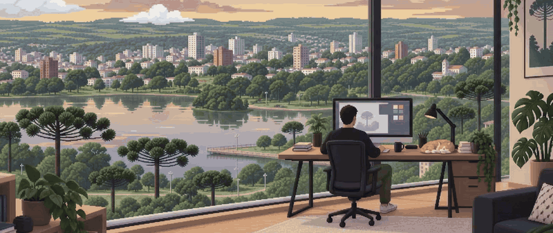
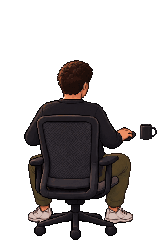

   

 

### `> about_me`

Product Designer and UX/UI Designer. I turn open questions into brands, interfaces and digital products with intention.

Since 2020 I've moved across visual identity, art direction, UX/UI and product — lately working with backlog, prioritization and feature validation inside a startup.

- 🎨 &nbsp;UX/UI · art direction · research & testing
- 🧩 &nbsp;product & marketing, close together
- 👾 &nbsp;after hours: pixel art scenes and tiny hardware
- 📍 &nbsp;Brazil

 

### `> inventory`

        

### `> quests`

**[SmallTV Pomodoro](https://github.com/davicorrea0/smalltv-pomodoro)** · custom firmware for a tiny desk clock (ESP8266). A Pomodoro timer with a pixel-art tomato that grows a plant as your focus streak grows, 8 built-in clock faces plus 24 downloadable ones, weather, Alexa voice control and a web panel in three languages. [Website →](https://davicorrea0.github.io/smalltv-pomodoro/)

 
<code>▮▮▮▮▮▮▯▯ thanks for stopping by — press START to continue</code>

