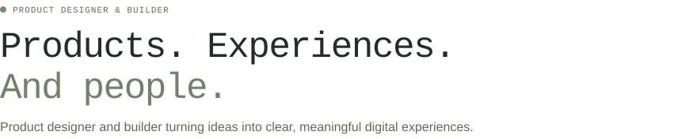
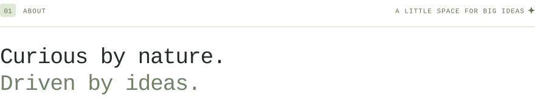
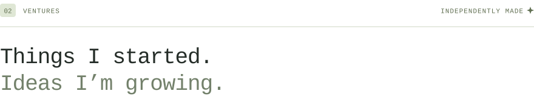
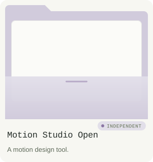
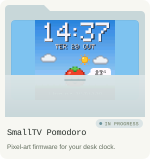
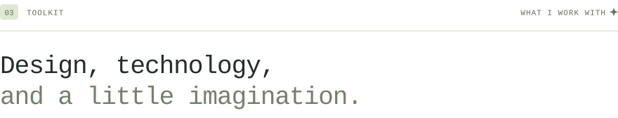
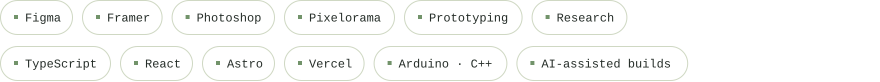
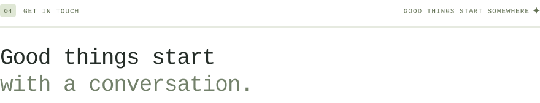
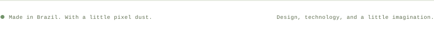

<picture>
  <source media="(prefers-color-scheme: dark)" srcset="assets/hero-dark.svg">
  
</picture>

  

<picture>
  <source media="(prefers-color-scheme: dark)" srcset="assets/chapter-01-dark.svg">
  
</picture>

I'm Davi Mattos, a product designer and builder from Guarapuava, Brazil, working where design and technology meet.

I like making complex things feel simple. From the first question to the final detail, I care about how things work as much as how they feel.

My path began in 2020 through visual design and digital marketing, then moved to interfaces, user journeys and product: art direction, UX/UI, and connecting backlog priorities with feature development.

> A dad, a gamer, and a curious human. There's a life around the work, too.

 

<picture>
  <source media="(prefers-color-scheme: dark)" srcset="assets/chapter-02-dark.svg">
  
</picture>

  
  

<picture>
  <source media="(prefers-color-scheme: dark)" srcset="assets/chapter-03-dark.svg">
  
</picture>

<picture>
  <source media="(prefers-color-scheme: dark)" srcset="assets/toolkit-dark.svg">
  
</picture>

  

<picture>
  <source media="(prefers-color-scheme: dark)" srcset="assets/chapter-04-dark.svg">
  
</picture>

A project, a possibility, or just a hello. I'd love to hear what you have in mind.

  

<picture>
  <source media="(prefers-color-scheme: dark)" srcset="assets/footer-dark.svg">
  
</picture>
